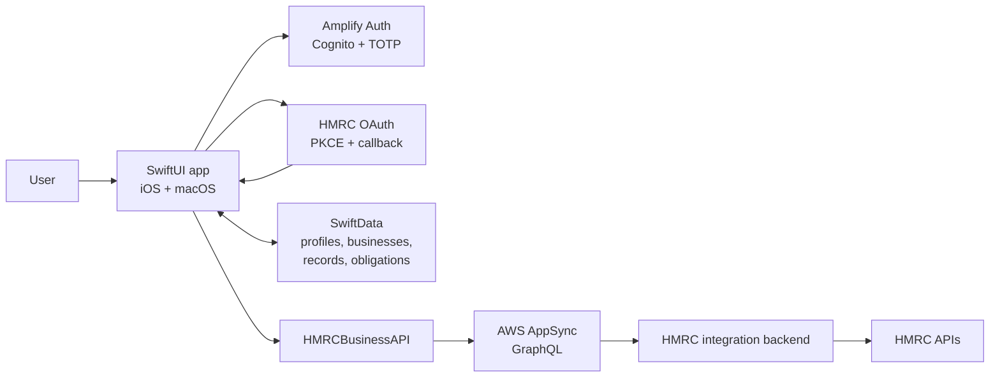

# BulBul SEQS

**A cross-platform SwiftUI frontend for secure HMRC self-employment record keeping and cumulative submissions.**

BulBul SEQS runs on iOS and macOS. It combines Amazon Cognito authentication, AWS AppSync through Amplify, HMRC OAuth, SwiftData persistence, digital-record import and export, obligation tracking, and cumulative-summary preparation in one native app.

> This repository contains the Apple-platform frontend. The AppSync and HMRC integration backend is configured through the tracked Amplify outputs, but its source code is not part of this repository.

## Features

- Amazon Cognito sign-in with mandatory TOTP multi-factor authentication.
- HMRC OAuth authorization-code flow with PKCE and callback validation.
- HMRC business, business-detail, and income-and-expenditure obligation retrieval.
- Local, user-isolated persistence with SwiftData.
- CSV import, editing, categorization, deletion, and export of digital records.
- Consolidated and non-consolidated cumulative-summary calculation and submission.
- HMRC sandbox test-business creation.
- Fresh fraud-prevention metadata for every applicable backend request:
  - iOS uses the `MOBILE_APP_VIA_SERVER` profile.
  - macOS uses the `DESKTOP_APP_VIA_SERVER` profile, including MAC addresses and the OS user.
  - The device identifier is preserved securely in Keychain.
- Native shared SwiftUI views with platform-specific behavior guarded for iOS and macOS.

## Architecture



Amplify is initialized in `BulBul-SEQS/BulBul_SEQSApp.swift` using:

```swift
try Amplify.configure(with: .amplifyOutputs)
```

The frontend contract lives in `BulBul-SEQS/AmplifyWorks/amplify_outputs.json`. It currently describes an AppSync API and Cognito user-pool authentication in `us-east-1`, with TOTP MFA required.

## Requirements

- A Mac with Xcode capable of building the project’s iOS 26.5 and macOS 26.5 deployment targets.
- Git.
- Access to the Amplify/Cognito environment described by `amplify_outputs.json`, or compatible outputs from your own backend.
- An HMRC Developer Hub application with:
  - an OAuth client ID;
  - redirect URI `com.jsv.bulbulseqs://hmrc-auth-callback`;
  - the required scopes and test or production API access.
- An Apple development team when running on a physical device or creating a signed archive.

Swift Package Manager resolves the dependencies automatically. The directly used packages are pinned in `Package.resolved`, including Amplify Swift `2.58.1` and Amplify UI Authenticator `1.3.1`.

## Setup

### 1. Clone and open the project

```bash
git clone https://github.com/VitalJeevanjot/BulBul-SEQS-SwiftUI-Frontend.git
cd BulBul-SEQS-SwiftUI-Frontend
open BulBul-SEQS.xcodeproj
```

Allow Xcode to finish resolving Swift Package Manager dependencies.

### 2. Create the local HMRC configuration

Copy the safe template:

```bash
cp BulBul-SEQS/environment_vars.example.plist BulBul-SEQS/environment_vars.plist
```

Open `BulBul-SEQS/environment_vars.plist` and replace only the placeholder client ID:

```xml
<key>HMRC_CLIENT_ID</key>
<string>YOUR-HMRC-CLIENT-ID</string>
```

The template already contains the HMRC test and production authorization URLs and the app callback URI.

`environment_vars.plist` is bundled as public app configuration. Never place an HMRC client secret, AWS credentials, tokens, passwords, or other confidential values in it. The file is intentionally ignored by Git.

The app currently uses the HMRC test authorization URL because `testing` is set to `true` in `BulBul-SEQS/GlobalConstants.swift`. Only switch this to production after configuring compatible production credentials, backend operations, redirect registration, and HMRC access.

### 3. Confirm the Amplify environment

The repository tracks `BulBul-SEQS/AmplifyWorks/amplify_outputs.json` because the app needs it at runtime. Before using a different backend, confirm that the replacement outputs provide the same:

- AppSync GraphQL endpoint and AWS region;
- Cognito user-pool authentication and TOTP configuration;
- model and non-model response shapes;
- custom query and mutation names;
- argument names, including `fraudPreventionHeaders`;
- authorization rules expected by the signed-in frontend.

Do not delete the tracked outputs unless the project is deliberately moved to a different Amplify configuration flow.

### 4. Configure signing

In Xcode:

1. Select the **BulBul-SEQS** project.
2. Select the **BulBul-SEQS** target.
3. Open **Signing & Capabilities**.
4. Choose your Apple development team.
5. Change the bundle identifier if your team cannot sign `com.jeevanjotsinghvital.BulBul-SEQS`.

If you change the OAuth callback scheme or bundle configuration, update all three locations together:

- the HMRC Developer Hub application;
- `BulBul-SEQS/environment_vars.plist`;
- `BulBul-SEQS/Info.plist`.

### 5. Run the app

Select the shared **BulBul-SEQS** scheme and choose either:

- an iOS Simulator; or
- **My Mac**.

On first use:

1. Create or sign in to a Cognito account.
2. Complete the required TOTP setup with an authenticator app.
3. Connect an HMRC account through the in-app OAuth flow.
4. Enter a valid NINO to retrieve businesses and obligations.

For sandbox testing, the app can create an HMRC test business. `BulBul-SEQS/Samples/SampleDigitalRecords.csv` contains 100 synthetic records that can be imported into a business with no existing digital records.

## Build and test from the command line

If Command Line Tools is selected instead of the full Xcode installation, select Xcode first:

```bash
sudo xcode-select --switch /Applications/Xcode.app/Contents/Developer
```

List the destinations installed on your machine:

```bash
xcodebuild \
  -project BulBul-SEQS.xcodeproj \
  -scheme BulBul-SEQS \
  -showdestinations
```

Build the iOS Simulator app:

```bash
xcodebuild \
  -project BulBul-SEQS.xcodeproj \
  -scheme BulBul-SEQS \
  -configuration Debug \
  -destination 'generic/platform=iOS Simulator' \
  CODE_SIGNING_ALLOWED=NO \
  build
```

Build the macOS app:

```bash
xcodebuild \
  -project BulBul-SEQS.xcodeproj \
  -scheme BulBul-SEQS \
  -configuration Debug \
  -destination 'platform=macOS' \
  CODE_SIGNING_ALLOWED=NO \
  build
```

Run the unit tests by substituting an installed simulator from `-showdestinations` if needed:

```bash
xcodebuild \
  -project BulBul-SEQS.xcodeproj \
  -scheme BulBul-SEQS \
  -destination 'platform=iOS Simulator,name=iPhone 17' \
  -only-testing:BulBul-SEQSTests \
  test
```

The current suite covers OAuth callbacks, identifier validation, response decoding, SwiftData cleanup and replacement, CSV import/export, HMRC tax-year boundaries, obligations, and cumulative-summary calculations.

## Project structure

| Path | Purpose |
| --- | --- |
| `BulBul-SEQS/BulBul_SEQSApp.swift` | App entry point, Amplify plugins, and SwiftData container. |
| `BulBul-SEQS/AmplifyWorks/` | Tracked Amplify runtime contract. |
| `BulBul-SEQS/LoggedInUserSwiftUIView/` | Authenticated shell, HMRC OAuth, PKCE, and MFA settings. |
| `BulBul-SEQS/HMRCJourney/API/` | GraphQL client, response models, and fraud-prevention headers. |
| `BulBul-SEQS/HMRCJourney/Models/` | SwiftData entities, validation, CSV handling, and calculations. |
| `BulBul-SEQS/HMRCJourney/ViewModels/` | HMRC journey state and orchestration. |
| `BulBul-SEQS/HMRCJourney/Views/` | Business, record, obligation, and summary interfaces. |
| `BulBul-SEQS/Samples/` | Synthetic CSV data for sandbox testing. |
| `BulBul-SEQSTests/` | Swift Testing unit and integration-style coverage. |

## Security notes

- Local configuration and secrets are ignored through `.gitignore`.
- The Cognito identity is used to isolate locally cached user data.
- Signing out removes the local SwiftData records associated with the session flow.
- HMRC fraud-prevention headers are collected immediately before applicable requests instead of being reused.
- iOS deliberately omits `Gov-Client-MAC-Addresses`; macOS supplies it as required by the desktop profile.
- Unsupported vendor fraud-header values remain explicit empty values rather than disappearing silently.
- Public AWS resource identifiers in Amplify outputs are configuration, not credentials; access is still controlled by Cognito and backend authorization rules.

Review the security model, HMRC production requirements, accessibility, tax calculations, and operational controls before treating this project as production tax software.

## How I used Codex to build this project

I developed BulBul SEQS in an iterative, human-directed collaboration with Codex. I supplied the product goals, repository context, HMRC and AWS constraints, and approval for consequential actions. Codex helped turn those requirements into code, tests, documentation, and a reviewable Git history.

The working loop was:

1. **Inspect before changing.** Codex explored the SwiftUI project and read `amplify_outputs.json` before touching API or authentication code. This kept GraphQL operation names, arguments, response shapes, region, and auth assumptions tied to the deployed backend contract.
2. **Implement in vertical slices.** We built Cognito/TOTP authentication, HMRC OAuth and PKCE, business persistence, obligations, digital-record CSV tools, cumulative summaries, and sandbox support as connected pieces rather than isolated mock screens.
3. **Preserve both platforms.** Codex kept shared SwiftUI code portable and used conditional compilation for UIKit, AppKit, networking, display, user, and MAC-address details.
4. **Treat compliance as code.** The HMRC mobile-app-via-server and desktop-app-via-server profiles became explicit implementation rules, including a Keychain-backed device ID and fresh fraud-prevention data for each request.
5. **Validate continuously.** Codex compared requests with Amplify outputs, checked diffs for accidentally staged secrets, built the app for an iOS Simulator and macOS, and ran the focused test suite. The completed workflow passed both platform builds and 16 tests before publication.
6. **Publish transparently.** Codex prepared descriptive commits and a pull request, then pushed only after I authorized the GitHub operations.

A representative prompt pattern for future work is:

```text
Inspect AGENTS.md and amplify_outputs.json first. Implement the feature in shared
SwiftUI without breaking iOS or macOS. Keep local secrets out of Git, compare all
GraphQL operations with the Amplify contract, add focused tests, and build both
platform targets before committing.
```

Codex accelerated repository analysis, implementation, verification, and documentation; design decisions, backend ownership, credentials, acceptance, and final publication remained human-controlled.

## Troubleshooting

### “HMRC configuration unavailable”

Confirm that `BulBul-SEQS/environment_vars.plist` exists, contains a real client ID, is valid XML, and is included in the app bundle.

### HMRC sign-in does not return to the app

Confirm that the redirect URI registered with HMRC exactly matches `com.jsv.bulbulseqs://hmrc-auth-callback`, including spelling, punctuation, and casing. Verify that the same scheme appears in the local plist and `Info.plist`.

### Amplify authentication or GraphQL requests fail

Check the endpoint, AWS region, Cognito configuration, authorization type, operation names, and auth rules in `amplify_outputs.json`. Make sure the signed-in account has access to the configured backend.

### `xcodebuild` says the active developer directory is Command Line Tools

Run the `xcode-select` command shown above, or invoke Xcode’s bundled `xcodebuild` directly from `/Applications/Xcode.app/Contents/Developer/usr/bin/xcodebuild`.

## Disclaimer

This project is not affiliated with or endorsed by HM Revenue & Customs. The included sample records are synthetic and are provided only for development and testing.
